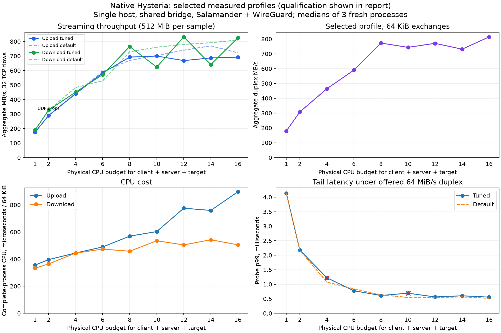

# Hysteria CPU-budget scaling and worker/pool tuning

Date: November 23, 2026. Runtime baseline: `bf3f517b` (native runtime is
unchanged from `4fd935d5`).

## Scope

The available machine has 16 physical cores and 32 SMT logical CPUs, one
Intel Xeon E5-2698 v3 socket. The requested CPU budgets are
1,2,4,6,8,10,12,14,16 physical cores. Each budget uses one logical CPU
per physical core; SMT siblings are not counted as additional cores.

The main matrix pins the **complete client/server/TCP-target benchmark
process** to each budget, with GOMAXPROCS equal to that budget. Native
runtime worker counts are set separately. This measures an end-to-end
resource budget on one host. It is not an isolated server scaling claim:
the 16 core case leaves no separate physical cores for a load generator.
Unrelated user processes and SMT siblings are not controlled or modified.
All samples record the starting load average and exact CPU affinity.

The transport is both-native, shared bridge, Salamander + WireGuard,
32 concurrent TCP flows and a configurable pool of 1–8 QUIC connections.
The fixture asserts the actual native engine/session count. Stream/window/
queue/memory budgets and all transport production defaults are unchanged.

## Workloads and validation

- Duplex: 8192 exchanges of 64 KiB in each direction, 1 GiB aggregate, evenly
  divided among 32 persistent flows. Every echoed payload is compared.
- Upload/download: 8192×64 KiB,512 MiB per direction, evenly divided among
  the same 32 flows. Timing includes all receivers' completion markers.
- Paced latency: 10,000 64-byte probe exchanges with 32 other TCP flows offering
  a common 64 MiB/s duplex background. Report the attained background rate
  with p99; unequal attained loads are not hidden.
- An additional small-exchange benchmark exists for reproductions and
  fixture checking.

All samples are fresh processes. Setup, TLS/auth and opening all flows are
outside the measured interval. CPU comes from the complete process's user+
system time, per timed operation. Peak RSS is `wait4`'s complete-process high
water mark, including setup, both native roles and the TCP target.
Per-socket kernel UDP drops are checked, using sockets created by the
current inner benchmark invocation. Go's initial one-operation calibration
and the final fixed-operation sample each take a separate pre-setup snapshot.
Before setup, the fixture waits for all prior native engines to stop. Native
pool cleanup is asynchronous (250 ms sweep); without that wait, retired
calibration sessions can consume the next sample's CPU budget even if their
socket counters are excluded.
One duplicated descriptor per measured UDP socket retains
its kernel counter through endpoint retirement; duplicates do no network I/O
and are closed at benchmark cleanup. Streaming TCP targets remain open until
the final counter snapshot. Any observed drop rejects the sample in the
driver, while preserving its throughput, CPU and RSS as overload evidence.

The initial counter fixture failed when completed endpoints disappeared
before the final snapshot. Those failed smoke logs are preserved; they are
not benchmark results. Later diagnostics also found calibration sockets in
the outer fixture's observation scope. Moving the baseline inside each
invocation fixes that scope. The large upload losses were reproduced on the
current server's exact port, however; they were not all a counter artifact.
Earlier search observations remain candidate-generation evidence only.
Final qualification uses a new binary hash and a separate output directory.
The intermediate `qualification-v3` results did not wait for engine cleanup.
They are retained as fixture-development evidence, not substituted for the
final drained-calibration `qualification-v4` matrix.

## Search and selection

The search is staged, not an exhaustive proof of a global optimum:

1. Sweep equal client/server worker counts from 1,2,4,6,8,10,12,14,16,
   bounded by the CPU budget, with eight pooled QUIC sessions. Include the
   actual automatic default as an explicit candidate. Use two repeats.
2. Around the two fastest candidates, try asymmetric client/server worker
   pairs, including one worker and up to twice the candidate count.
3. For the two fastest worker pairs, compare pool sizes 1/2/4/8 in two
   repeats, retaining the actual default too.
4. Screen the two fastest search configurations, the default and smaller
   pools/worker pairs using upload and download. A large pool can rank highly
   in exchange-based duplex while overflowing receive queues under continuous
   streaming. Add client/server pairs 1/1, 2/2, 1/2, 2/1 and server workers
   up to 4/8 with pool2, bounded by the core budget.
5. Recheck the two fastest loss-free streaming candidates and the default
   with three fresh repetitions of duplex, upload, download and paced latency.
6. Where the small-pool alternatives miss the latency gate, inspect intermediate
   worker/pool settings. The final drained-calibration qualification includes
   client2/server4/pool4, client3/server4-or8/pool3 and client4/server8/pool2
   at 8–16 cores, along with the earlier finalists and the default.

Search results and final qualification observations remain separate.
Order reverses between repeats and candidate order is reproducibly shuffled.
The default is client/server workers=min(cores,4), with pool2 below 8 cores
and pool4 from 8 cores upward, matching the current code's policy.

The balanced recommendation considers finalists with paced p99 no more than
10% above the default at at least 57.6 MiB/s attained background (90% of offered
load). Among configurations within 3% of the best geometric mean of upload/
download throughput, choose lower total upload+download CPU, then peakRSS.
If no finalist satisfies the latency/load gates, the result explicitly
marks the failed gate instead of presenting it as a clean balanced win.
All finalist data and the fastest raw configuration are retained for review.

## Reproduction

```sh
XHYS_SCALING_CPUS=4,5,6,7,8,9,10,11,12,13,14,15,0,1,2,3 \
  bash native/libxhysteria/bench-scaling.sh build_assets/core-scaling-reproduction
```

The script builds the harness against a content-hashed native archive.
`XHYS_SCALING_BINARY` can reuse an existing harness. `XHYS_SCALING_CORES`
selects budgets; `XHYS_SCALING_SEARCH_REPEATS` and
`XHYS_SCALING_FINAL_REPEATS` default to 2 and 3. Existing successful observations
can be resumed only with the identical binary and methodology manifest;
failed logs are preserved and do not silently become passing observations.
`XHYS_SCALING_FINALISTS` accepts a JSON object keyed by core budget, with
arrays of `[client_workers, server_workers, pool_size]`. This reuses previous
candidate settings while performing fresh streaming screening and final
qualification. The file's hash is recorded in the new manifest; old timings
are not imported into the fresh results.
`XHYS_SCALING_SKIP_SCREEN=1` (requires a finalists file) qualifies every
supplied candidate rather than selecting two via another screening pass.

Artifacts:ignored `build_assets/core-scaling-20261123/`, with topology,
binary SHA-256, exact commands/environment, every observation, search data,
finalist summaries, recommendations CSV and per-budget environment profiles.
Profiles apply before runtime initialization. They describe this combined
fixture and require remeasurement for a separated production deployment.
No global defaults, production deployment, remote restart or neighboring
worktree changes are part of this qualification.

## Final drained-calibration results

Three fresh processes per configuration and workload. Decimal MB/s;
duplex is aggregate in both directions, not a one-way speed. CPU is
complete-process microseconds per64KiB, and RSS is the maximum across
workload median high-water marks. “Clean” requires all12samples to have
zero measured UDP drops. The p99/load gate columns remain separate.

| Cores | Client/server/pool | Upload MB/s | Download MB/s | Duplex MB/s | CPU up/down µs | RSS MiB | Paced p99 µs | Clean | p99 gate |
| ---: | :---: | ---: | ---: | ---: | ---: | ---: | ---: | :---: | :---: |
| 1 | 1/1/2 | 174.47 | 188.79 | 179.27 | 355.9/332.4 | 156.8 | 4136.0 | yes | yes |
| 2 | 2/2/2 | 289.51 | 327.15 | 308.25 | 396.3/364.6 | 168.4 | 2176.0 | NO | yes |
| 4 | 2/2/2 | 439.67 | 450.46 | 464.39 | 445.0/444.3 | 181.0 | 1223.0 | yes | NO |
| 6 | 2/6/2 | 583.73 | 571.64 | 590.05 | 489.6/473.9 | 191.6 | 775.9 | yes | yes |
| 8 | 2/4/4 | 692.37 | 765.16 | 772.51 | 569.4/458.1 | 151.6 | 613.2 | yes | yes |
| 10 | 4/8/2 | 699.62 | 623.44 | 743.47 | 603.3/535.6 | 147.0 | 693.2 | yes | NO |
| 12 | 2/4/4 | 668.33 | 831.11 | 770.71 | 775.7/504.7 | 154.1 | 563.6 | yes | yes |
| 14 | 4/8/2 | 686.77 | 641.13 | 731.21 | 759.1/542.8 | 149.3 | 603.7 | yes | yes |
| 16 | 2/4/4 | 691.93 | 825.09 | 813.98 | 897.0/505.5 | 153.6 | 556.9 | yes | yes |

All attained background rates and load gates are in the result JSON.
No profile with a failed sample is advertised as loss-free. A budget with
no fully clean finalist retains a marked `.candidate.env`, not a qualified
`.env`. A failed relative p99 gate is also shown even if all UDP counters
are zero. Three repeats cannot prove a production loss-free guarantee.

### Selected-profile ranges (three samples per workload)

| Cores | Upload min–max MB/s | Download min–max MB/s | Paced p99 min–max µs | Failed selected samples |
| ---: | ---: | ---: | ---: | ---: |
| 1 | 140.04–186.64 | 184.71–194.18 | 3900.0–4531.0 | 0 |
| 2 | 285.50–294.73 | 321.40–337.76 | 2110.0–2357.0 | 1 |
| 4 | 432.15–467.23 | 447.48–473.65 | 1086.0–1266.0 | 0 |
| 6 | 551.40–587.05 | 555.51–633.36 | 723.5–801.0 | 0 |
| 8 | 690.75–700.07 | 764.26–778.37 | 610.6–673.3 | 0 |
| 10 | 690.46–715.95 | 611.05–631.06 | 689.0–765.2 | 0 |
| 12 | 655.18–673.14 | 813.04–831.22 | 512.8–613.0 | 0 |
| 14 | 670.59–689.18 | 635.90–644.94 | 595.6–671.4 | 0 |
| 16 | 679.61–709.55 | 820.32–841.84 | 510.5–559.9 | 0 |

### CPU profiling

Separate `perf record -e cpu-clock:u -F199 -g` duplex runs for all nine
budgets; not substituted for unprofiled throughput samples. These sample
user CPU in both native roles and the Go workload, not kernel CPU or an
isolated server. The recording includes TLS/setup, Go calibration and cleanup,
unlike the timed CPU/op interval. The prominent elliptic-curve symbol is
therefore not evidence that bulk-data processing spends 5–7% on handshakes.
Top symbols and full configuration are in
`hysteria-core-scaling-20261123/cpu-profiles.json`.

| Cores | Top sampled userCPU symbols |
| ---: | --- |
| 1 | `ring_core_0_17_14__ecp_nistz256_ord_mul_mont_nohw` 6.73%; `runtime.memmove` 4.29%; `blake2b_simd::sse41::compress2_loop` 3.83% |
| 2 | `ring_core_0_17_14__ecp_nistz256_ord_mul_mont_nohw` 6.93%; `<quinn_proto::connection::Connection>::process_payload` 3.61%; `blake2b_simd::sse41::compress2_loop` 3.31% |
| 4 | `runtime.memmove` 5.67%; `ring_core_0_17_14__ecp_nistz256_ord_mul_mont_nohw` 5.39%; `blake2b_simd::sse41::compress2_loop` 3.53% |
| 6 | `ring_core_0_17_14__ecp_nistz256_ord_mul_mont_nohw` 6.12%; `blake2b_simd::sse41::compress2_loop` 4.03%; `runtime.memmove` 3.86% |
| 8 | `ring_core_0_17_14__ecp_nistz256_ord_mul_mont_nohw` 5.19%; `runtime.memmove` 5.04%; `<quinn_proto::connection::Connection>::process_payload` 3.54% |
| 10 | `ring_core_0_17_14__ecp_nistz256_ord_mul_mont_nohw` 5.78%; `<quinn_proto::connection::Connection>::process_payload` 3.75%; `runtime.memmove` 3.43% |
| 12 | `ring_core_0_17_14__ecp_nistz256_ord_mul_mont_nohw` 6.68%; `runtime.memmove` 4.14%; `<quinn_proto::connection::Connection>::process_payload` 3.19% |
| 14 | `ring_core_0_17_14__ecp_nistz256_ord_mul_mont_nohw` 4.84%; `runtime.memmove` 3.42%; `runtime.stealWork` 3.35% |
| 16 | `ring_core_0_17_14__ecp_nistz256_ord_mul_mont_nohw` 5.40%; `runtime.memmove` 3.43%; `runtime.stealWork` 3.36% |



Complete finalist medians/min/max and rejected sample metrics:
`hysteria-core-scaling-20261123/results.json`. Candidate settings and
per-core environments are in the same directory. Raw logs and separate
perf recordings remain in ignored `build_assets/core-scaling-20261123/`.

### Reproduce the final candidate matrix

```sh
XHYS_SCALING_CPUS=4,5,6,7,8,9,10,11,12,13,14,15,0,1,2,3 \
XHYS_SCALING_FINALISTS="$PWD/docs/hysteria-core-scaling-20261123/finalists.json" \
XHYS_SCALING_SKIP_SCREEN=1 \
  bash native/libxhysteria/bench-scaling.sh build_assets/core-scaling-final-reproduction
```

These are the best measured settings among a bounded candidate search, not a
proof of a global optimum. Defaults and production runtime code remain
unchanged. The 400/370 MB/s target is exceeded by all three final streaming
samples of each selected profile at 4–16 cores. It is not reached at 1–2
cores in this combined-budget fixture.

At 2 cores neither finalist passes the zero-drop qualification; the selected
candidate has one failed download sample (6 kernel UDP drops). At 4 and 10
cores the selected loss-free profiles miss the relative p99 gate. Those
trade-offs are explicit, not reported as clean balanced wins.

Upload CPU cost rises at the largest budgets even when throughput plateaus.
Adding physical cores does not give linear speedup for a fixed 32-flow pool.
Production profiles require remeasurement with independent client/server
machines, actual users, RTT and bandwidth limits. No isolated server-capacity,
VPS deployment or Android device claim follows from these measurements.

## Validation

- 130 release native engine tests passed, one ignored.
- Go race tests passed for `transport/internet/xhysteria`,
  `transport/internet/hysteria`, `transport/internet/handoff`,
  `cmd/nodex-xray-supervisor` and `proxy/hysteria`.
- All four new scaling workloads passed 128-operation race smokes.
- Seven Python parser/selection tests, Bash syntax and ShellCheck passed.
- The shell wrapper completed a fresh one-repeat reuse-binary smoke; these
  smoke timings are not included in the three-repeat final matrix.
- At 1/4/16 cores, the selected settings passed packet-mask compatibility,
  concurrent transfers, short-flow credit recovery, capacity rejection/
  recovery and the 100 ms RTT fixture.
- At each of those three budgets, strict direct/cascade UDP under TCP load
  delivered 8000/8000 packets across 256/4096-byte scenarios, with zero sampled
  kernel UDP drops and duplicates.
- Masked third-party quic-go clients passed stream-limit/recycling checks
  through both shared and socket bridges at 1/4/16 cores.

The functional UDP workload differs from uninterrupted 32-flow streaming:
passing its loss checks does not invalidate the failed streaming observations.
No repository-wide test-suite success, new 15-minute soak, Android device
measurement or production deployment is claimed. Existing unrelated
repository-wide Go/Clippy limitations are unchanged.
